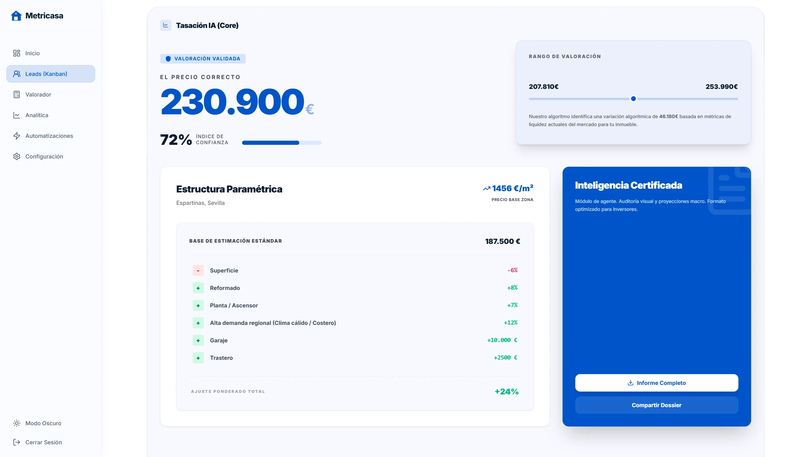
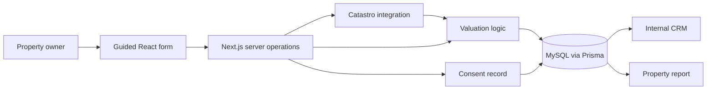

# Metricasa · property valuation and CRM

I built a property valuation flow that connects public Catastro data, information supplied by the owner and an internal CRM. The product is a **private beta**, with development kept local.

**My role:** product flow, application architecture, fullstack development and integration. **Stack:** TypeScript, Next.js, React, Tailwind CSS, Prisma, MySQL and Auth.js/NextAuth.

[Product case study](https://www.ricardohuertas.es/trabajos/metricasa/) · [About my work](https://www.ricardohuertas.es/)

*Private-beta interface. The displayed estimate and confidence indicator are product outputs, not an independently validated measure of valuation accuracy. Labels in the screenshot are part of that version of the interface.*

## The problem

A property enquiry is more useful when it carries the context required for the next conversation. I designed Metricasa around a guided flow: identify the property, collect its characteristics, calculate an estimate and preserve the information for follow-up.

The internal application includes lead management, property records, valuations, consent records, assignments, activities and automation rules.

## Architecture

## Engineering decisions

**Separate property data from the contact.** The relational schema distinguishes the lead, property, valuation and consent record. This preserves context without making one large form payload responsible for every subsequent operation.

**Make data resolution explicit.** The price resolver distinguishes postal-code, municipality, province and national fallback sources. Location normalisation handles accents and formatting. A broader fallback can return an estimate, but it should not be confused with more granular evidence.

**Keep the external integration on the server.** Catastro access and valuation operations sit behind the public form. The UI collects input and explains progress; it does not become the source of truth for a property record or an authenticated CRM action.

**Record consent as data.** The project preserves acceptance context, including time and terms version. That supports traceability; a consent table alone does not certify legal compliance.

## Verification and limitations

The private project contains tests for the price resolver, valuation mapping, CRM actions and comparable-property processing. This repository presents the case; it does not run the private application's test suite.

The valuation is an estimate. Catastro data, regional reference prices and comparable-property inputs have different coverage and limitations. This case makes no claim about independently measured accuracy, completed sales, adoption or response-time benchmarks.

The beta is not a public SaaS deployment. Its source, credentials and operational data remain private. The screenshots are selected portfolio material, not a live connection to the application.

## Read this case

This repository contains documentation and one product screenshot; there is no application to install.

The case does not grant a licence to the underlying private application. Catastro and other third-party names belong to their respective organisations.
