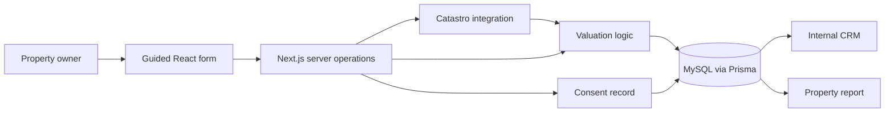

# Metricasa · property valuation and CRM

I built a property valuation flow that connects public Catastro data, information supplied by the owner and an internal CRM. The product is a **private beta**, with development kept local.

**My role:** product flow, application architecture, fullstack development and integration. **Stack:** TypeScript, Next.js, React, Tailwind CSS, Prisma, MySQL and Auth.js/NextAuth.

[Product case study](https://www.ricardohuertas.es/trabajos/metricasa/) · [About my work](https://www.ricardohuertas.es/)

*Property valuation workspace from the private beta.*

## The problem

A property enquiry is more useful when it carries the context required for the next conversation. I designed Metricasa around a guided flow: identify the property, collect its characteristics, calculate an estimate and preserve the information for follow-up.

The internal application includes lead management, property records, valuations, consent records, assignments, activities and automation rules.

## Architecture

## Engineering decisions

**Separate property data from the contact.** The relational schema distinguishes the lead, property, valuation and consent record. This preserves context without making one large form payload responsible for every subsequent operation.

**Make data resolution explicit.** The price resolver distinguishes postal-code, municipality, province and national fallback sources. Location normalisation handles accents and formatting. A broader fallback can return an estimate, but it should not be confused with more granular evidence.

**Keep the external integration on the server.** Catastro access and valuation operations sit behind the public form. The UI collects input and explains progress; it does not become the source of truth for a property record or an authenticated CRM action.

**Record consent as data.** The project preserves acceptance context, including time and terms version, so the team can trace what was accepted alongside the enquiry.

## Verification and status

The private project contains tests for the price resolver, valuation mapping, CRM actions and comparable-property processing.

Private beta; valuations are indicative estimates. This repository contains the technical case study and a selected screenshot; application source is private.
